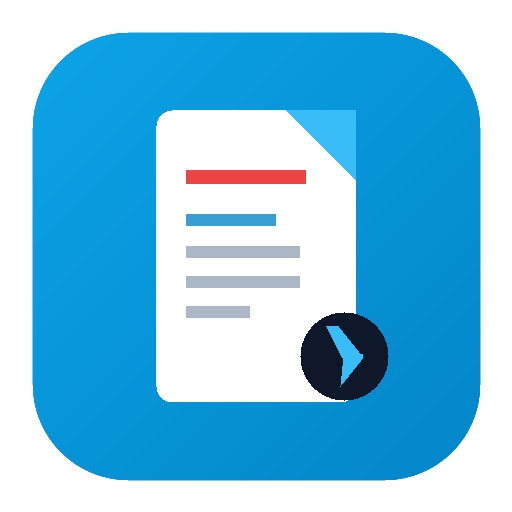
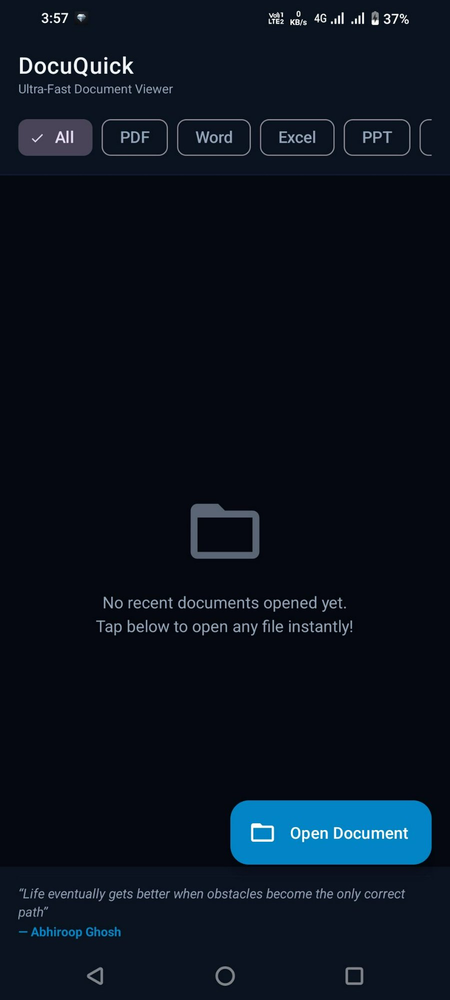
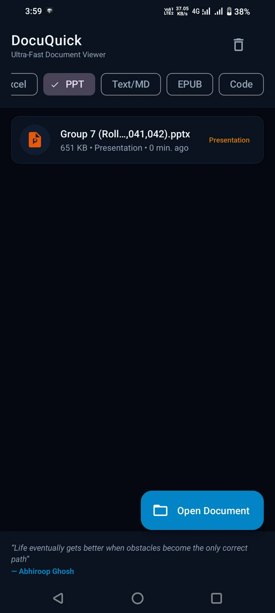

<p align="center">
  
</p>

<h1 align="center">DocuQuick: Ultra-Fast Android All-Document Viewer</h1>

<p align="center">
  <b>Minimalist, battery-efficient, and 100% offline all-document viewer for Android smartphones (&lt;3.5 MB)</b>
</p>

<p align="center">
  <a href="https://github.com/lord-Abhiroop/DocuQuick/releases/latest"></a>
  
  
  
</p>

---

## 📸 Screenshots

| Clean Empty State | Recents & Cache Management | Category Filtering |
|:---:|:---:|:---:|
|  |  |  |

---

## 🚀 Key Features & Highlights

- **Ultra-Lean Size (3.2 MB APK)**:
  - Zero heavy external dependencies (no Apache POI, no bloated binary renderers).
  - Uses native Android hardware-accelerated APIs (`PdfRenderer`, `XmlPullParser`, `ZipInputStream`, `BitmapFactory`, and hardware-accelerated `WebView`).
- **Universal Hardware-Adaptive Sharpness**:
  - Dynamically queries physical display metrics at runtime (`displayMetrics.density` & `widthPixels`) to render 1:1 hardware pixel-perfect text on any screen (720p, 1080p FHD+, 1440p QHD+, AMOLED, and foldables/tablets).
- **Password-Protected Document Unlock**:
  - Automatically intercepts encrypted documents (Aadhaar cards, bank e-statements, payslips) and unlocks them with a floating password unlock bar and AES-256 decryption.
- **One-Tap Cache & History Cleanup**:
  - Dedicated trash button instantly clears recents history, WebView storage, and temp document caches with a strict 20 MB / 12-file automatic LRU cap.
- **Zero-Latency Launch & Clean Typography**:
  - Opens documents instantly without splash screens, telemetry, or network latency.
  - Specially designed reading typography: optimal line leading (`1.45x`), generous margins (`18dp`), clear paragraph hierarchy, and high-contrast text.
- **Privacy First (100% Offline)**:
  - Requires **zero internet permissions**. Documents never leave your phone.
- **Universal Android Integration**:
  - Registered intent filters for all document MIME types and extensions.
  - Seamlessly handles *"Open with..."* and *"Share to..."* from WhatsApp, Telegram, Gmail, Chrome, and Android Files.
- **In-App Split-Screen Document Compare**:
  - Compare any two documents side-by-side or top/bottom simultaneously (PDF vs PDF, Word vs PDF, Excel vs Word, etc.).
  - 1-tap quick selection from recents or browse files, with live swap (`⇅`), independent zoom/scrolling, and **Synchronized Dual-Scroll (`🔗`)** to scroll both documents in lockstep.
- **Spreadsheet Quick-Stats Bar (`SUM`, `AVG`, `COUNT`, `MIN`, `MAX`)**:
  - Tap any spreadsheet column header or numeric cell to instantly inspect statistical aggregations (Sum, Average, Min, Max, Count) without full editor bloatware.
- **Bionic Speed Reading Mode**:
  - 1-tap toggle that highlights fixation points (bolding initial syllables) across all documents for 2× to 3× faster reading with reduced eye fatigue.
- **Peep Shield (Anti-Shoulder Surfing Privacy Mask)**:
  - Draggable reading slit overlay that blacks out surrounding screen areas, preventing prying eyes from reading confidential documents in public transport or offices.
- **Visual Snippet / Quote Card Generator**:
  - 1-tap excerpt card maker that renders highlighted quotes into beautiful cards with document citations, ready to share directly to WhatsApp, Telegram, or social media.
- **Hands-Free Auto-Scroll**:
  - Smooth, variable-speed auto-scrolling (`0.5x` to `3.0x`) with tap-to-pause for studying, cooking recipes, or hands-free reading.
- **Reading Position Memory (Auto-Resume)**:
  - Automatically remembers and restores your exact reading page (PDF) and scroll position (Word, Markdown, EPUB, Code, Text) across app launches.
- **"Go to Page / Slide" Jump Dialog**:
  - Tap the floating status pill to jump straight to any page or slide number instantly.
- **Native Offline Text-to-Speech (Read Aloud)**:
  - 100% offline, zero-network reading assistant using Android system TTS with play/stop toggle for Word, EPUB, Text, Markdown, and Code.
- **Universal Print & Save as Clean PDF**:
  - One-tap print or clean PDF export using Android's native `PrintManager` for all supported formats.
- **Adaptive Reading Themes & Eye-Care Tints**:
  - Quick cycle: Clean Light, **Warm Sepia** (eye-care reading tint), **Slate Dark**, and **Pure AMOLED Black** (battery-saving OLED mode).
- **In-Document Search**:
  - Real-time text search with match highlighting, match counter, and Up/Down navigation.
- **Dynamic Text Sizing**:
  - One-tap font scaling from 85% to 150% with automatic preference memory.

---

## 📂 Supported Document Formats

| Category | Formats | Implementation Engine |
|---|---|---|
| **PDF** | `.pdf` | Native Android `PdfRenderer` + asynchronous tile cache (60 FPS smooth scrolling) |
| **Word** | `.docx`, `.doc` | Streaming XML parser (`XmlPullParser`) extracting headings, bold, italic, underline, lists, and tables |
| **Spreadsheets** | `.xlsx`, `.xls`, `.csv`, `.tsv` | High-speed XML string table parser + interactive sticky header table view |
| **Text & Docs** | `.txt`, `.rtf`, `.log` | Selectable native text engine with word count & reading time stats |
| **Markdown** | `.md`, `.markdown` | Custom Markdown span parser (headings, blockquotes, code blocks, lists, dividers) |
| **E-Books** | `.epub` | Lightweight EPUB container extractor + hardware-accelerated responsive reader |
| **Code & Data** | `.json`, `.xml`, `.py`, `.js`, `.kt`, `.java`, `.cpp`, `.sql`, `.yaml`, `.html`, `.css` | Syntax colorizer with line numbering and auto-indented JSON formatting |
| **Images** | `.png`, `.jpg`, `.jpeg`, `.webp`, `.svg`, `.gif`, `.bmp` | Subsampled `BitmapFactory` memory-safe decoding with image dimensions pill |

---

## 🛠️ How to Build the APK

### Option 1: Automatic Build via GitHub Actions (Recommended)
This repository includes a pre-configured GitHub Actions workflow: [build-apk.yml](.github/workflows/build-apk.yml).
1. Push this project to GitHub.
2. Go to the **Actions** tab on your GitHub repository.
3. The workflow builds both **Debug** and **Release APKs** automatically in ~90 seconds.
4. Download the ready-to-install `.apk` artifact directly to your phone!

### Option 2: Build Locally with Gradle
If you have JDK 17+ installed on your computer:
```bash
# Clone or navigate to the directory
cd docuquick-android

# Build Debug APK:
./gradlew assembleDebug

# Build Release APK (Minified & Optimized under 2.5 MB):
./gradlew assembleRelease
```
The output APK will be generated at:
- `app/build/outputs/apk/release/app-release-unsigned.apk`
- `app/build/outputs/apk/debug/app-debug.apk`

---

## 📱 Project Architecture

```
docuquick-android/
├── .github/workflows/build-apk.yml    # CI/CD automated APK compiler
├── app/
│   ├── build.gradle.kts               # Android build configuration (MinSdk 24, TargetSdk 35)
│   ├── proguard-rules.pro             # R8 bytecode optimization rules
│   └── src/main/
│       ├── AndroidManifest.xml        # System intent filters for all file types
│       ├── java/com/docuquick/app/
│       │   ├── DocuQuickApp.kt        # App lifecycle & theme manager
│       │   ├── MainActivity.kt        # Quick Launcher & Recents Dashboard
│       │   ├── ViewerActivity.kt      # Main Reader & View Orchestrator
│       │   ├── model/
│       │   │   ├── DocumentType.kt    # File detection & category enum
│       │   │   └── RecentFile.kt      # Recents model
│       │   ├── parser/
│       │   │   ├── DocxParser.kt      # Zero-dependency DOCX parser
│       │   │   ├── ExcelParser.kt     # XLSX & CSV parser
│       │   │   ├── MarkdownParser.kt  # Native Markdown engine
│       │   │   ├── EpubParser.kt      # EPUB book extractor
│       │   │   └── CodeHighlighter.kt # Syntax highlighting & line numbers
│       │   ├── ui/
│       │   │   ├── PdfAdapter.kt      # Recycled page bitmap renderer
│       │   │   └── RecentFilesAdapter.kt
│       │   └── util/
│       │       ├── FileUtils.kt       # Size formatting & URI resolvers
│       │       └── PreferencesManager.kt
│       └── res/                       # Vector icons, Material 3 layouts & themes
├── build.gradle.kts
└── settings.gradle.kts
```
